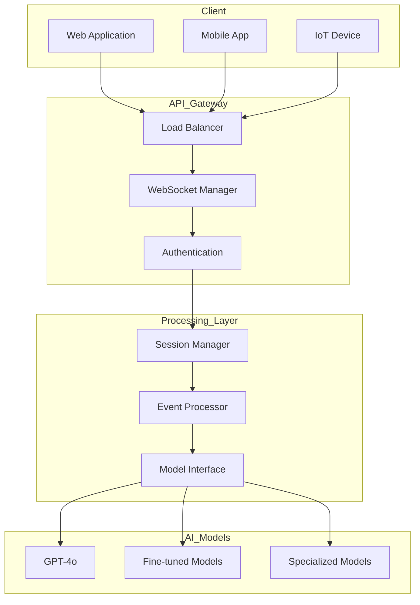

# Mastering OpenAI's Realtime API for Enterprise Applications

> Canonical, deduplicated reference. The source dataset contained four near-identical copies of this guide plus a fifth fragment; this is the single canonical version. See [`QUALITY_REPORT.md`](../QUALITY_REPORT.md) for the analysis.

## Table of Contents

1. [Introduction](#1-introduction)
2. [Architecture & Core Components](#2-architecture--core-components)
3. [Setting Up and Managing Realtime Sessions](#3-setting-up-and-managing-realtime-sessions)
4. [WebSocket Event Handling](#4-websocket-event-handling)
5. [Fine-Tuning & Model Customization](#5-fine-tuning--model-customization)
6. [Security & Compliance](#6-security--compliance)
7. [Performance Optimization](#7-performance-optimization)
8. [Monitoring & Debugging](#8-monitoring--debugging)
9. [Error Handling & Recovery](#9-error-handling--recovery)
10. [Scaling Considerations](#10-scaling-considerations)
11. [Integration Patterns](#11-integration-patterns)
12. [Testing & Quality Assurance](#12-testing--quality-assurance)
13. [Deployment Strategies](#13-deployment-strategies)
14. [Maintenance & Updates](#14-maintenance--updates)
15. [Advanced Features & Optimizations](#15-advanced-features--optimizations)
16. [Future Trends](#16-future-trends)
17. [Ethical Considerations](#17-ethical-considerations)

---

## 1. Introduction

The Realtime API is OpenAI's solution for building interactive, low-latency applications. It enables persistent WebSocket communication between clients and AI models, supporting multimodal input (text, audio, structured data) and bi-directional streaming. Typical use cases include voice assistants, live customer support, interactive gaming, real-time translation, and conversational agents.

### Technical Prerequisites

- WebSocket protocol fundamentals
- Async/await programming
- API authentication and key management
- Performance and latency optimization

---

## 2. Architecture & Core Components



| Layer | Responsibility |
|-------|----------------|
| Client | WebSocket clients in web/mobile/IoT |
| API Gateway | Load balancing, WS connection management, auth |
| Processing | Session state, event routing, model interface |
| Models | GPT-4o, fine-tuned, specialized variants |

---

## 3. Setting Up and Managing Realtime Sessions

See [`python/realtime_session.py`](../python/realtime_session.py) for the canonical, bug-fixed implementation. The original dataset's snippets contained several defects (undefined `API_KEY`, deprecated `datetime.utcnow()`, legacy SDK shape, signature mismatch in `_migrate_session_data`); those are all corrected in the runnable version.

Key design notes:

- **Modularization** – `_get_metadata` / `_get_configuration` separate concerns so changing metadata shape doesn't ripple into session creation.
- **Encapsulated metrics** – `_initialize_metrics` keeps `create_session` focused.
- **Session renewal** – Always migrate context before tearing down the previous session.

---

## 4. WebSocket Event Handling

```typescript
interface RealtimeEvent {
  type: 'message' | 'function_call' | 'error' | 'status';
  timestamp: number;
  payload: unknown;
  metadata: {
    session_id: string;
    user_id: string;
    request_id: string;
  };
}

interface MessageEvent extends RealtimeEvent {
  payload: {
    content: string;
    role: 'user' | 'assistant' | 'system';
    tokens: number;
  };
}

interface FunctionCallEvent extends RealtimeEvent {
  payload: {
    function_name: string;
    arguments: Record<string, unknown>;
    context: Record<string, unknown>;
  };
}
```

Route incoming events through a typed dispatcher keyed on `event.type`; unknown types should be logged but not raise.

---

## 5. Fine-Tuning & Model Customization

Workflow:

1. Format training data as `{messages: [{role, content}, ...]}` JSONL.
2. Upload via the Files API with `purpose='fine-tune'`.
3. Create a `FineTuningJob` with hyperparameters (`n_epochs`, `batch_size`, `learning_rate_multiplier`).
4. Evaluate on a held-out test set; report accuracy, average latency, and p95 latency.

---

## 6. Security & Compliance

- **Authentication** – Validate JWT on every request; maintain a token blacklist for revocation.
- **Rate limiting** – Per-user-tier (default vs premium), backed by Redis counters with TTL windows.
- **Key safety** – Never expose API keys client-side; scope keys per service.
- **Compliance** – Plan for GDPR/CCPA; consider federated learning where data residency matters.

---

## 7. Performance Optimization

- **Connection pooling** – Reuse WebSocket connections; cap with a queue.
- **Response caching** – Hash request payloads and cache by SHA-256; default TTL 1h.
- **Streaming optimization** – Choose buffer size and compression level based on payload characteristics.

---

## 8. Monitoring & Debugging

- **Telemetry** – Emit metrics via Prometheus; trace with OpenTelemetry spans per request.
- **Structured logging** – JSON logs to a queue, batched into Elasticsearch.
- **Always log** – Event IDs from both client and server for correlation.

---

## 9. Error Handling & Recovery

- **Typed handlers** – Map `ConnectionError`, `TokenError`, `RateLimitError`, `ModelError` to specific handlers; default for unknowns.
- **Circuit breaker** – CLOSED → OPEN after N consecutive failures; HALF_OPEN probe after `reset_timeout`; back to CLOSED on success.

---

## 10. Scaling Considerations

- **Horizontal scaling** – Target 70% CPU utilization; autoscale replicas based on real metrics.
- **Load balancing** – Health-check backends; pick servers by composite score (load, latency, request fit).

---

## 11. Integration Patterns

- **Event-driven** – Publish to Kafka for durability; fan out to in-process subscribers.
- **API gateway** – Apply middleware in order, rate-limit, then route by path.

---

## 12. Testing & Quality Assurance

- **Automated suite** – Setup → execute → assert → teardown per case; emit `PASSED` / `FAILED` / `ERROR` with duration.
- **Load testing** – Simulate concurrent users with `aiohttp.ClientSession`; collect aggregate metrics from a `MetricsCollector`.

---

## 13. Deployment Strategies

- **Blue-green** – Deploy green, health-check, switch traffic, retire blue. Roll back the new env on failure.
- **Canary** – Start at 5% traffic, monitor for 30 min, escalate or roll back.

---

## 14. Maintenance & Updates

- **Version management** – Compatibility-check before registering; plan multi-step update paths.
- **Database migrations** – Always backup; apply steps inside a transaction; verify integrity before committing the migration history.

---

## 15. Advanced Features & Optimizations

- **Stream optimization** – Adaptive buffer sizing + compression by payload profile.
- **Layered caching** – Memory → Redis → Disk, with a predictor choosing the optimal storage tier per access pattern.

---

## 16. Future Trends

- AI-powered hyper-personalization driven by adaptive learning models.
- Federated learning to keep training data on-device for compliance.
- Expanded multimodal: video, real-time image, AR inputs.
- Autonomous system-to-system interactions for supply chain, predictive maintenance, smart cities.

---

## 17. Ethical Considerations

- **Bias mitigation** – Test for representativeness of training data; monitor for drift.
- **Transparent disclosure** – Users should know when they are interacting with AI.
- **Responsible usage** – Avoid surveillance, misinformation, or discriminatory deployments.
